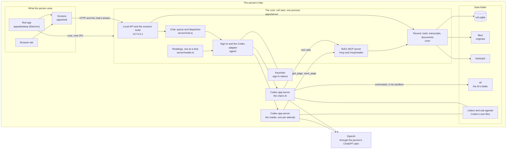
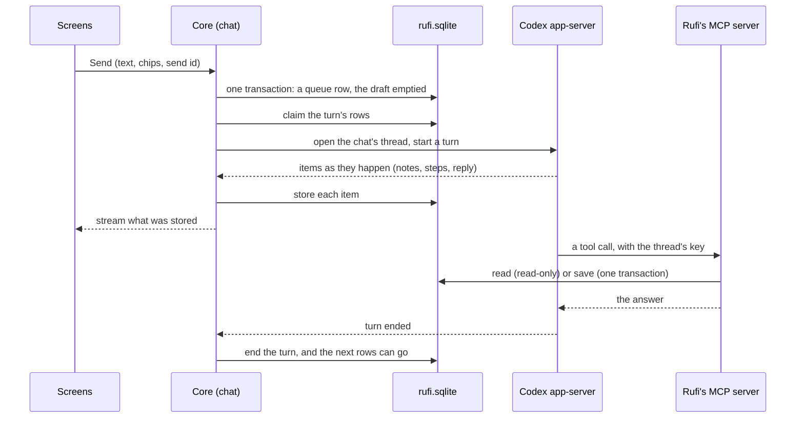

# How Rufi works

For developers: the main parts of Rufi, where its data lives and how it moves. It stays high level; the code and its tests have the detail, and the ADRs in [`adr/`](adr/) say why. The rules for working in the code are in [`AGENTS.md`](../AGENTS.md); what people see and do is in the [help](help/index.md).

## The parts

Everything runs on the person's Mac. One process, the core (`rufi start`), owns the data folder; the screens, the Rufi app and the AI reach the record only through it.

| Part                                    | What it does                                                                                                                                             | Borders                                                                                                                                         |
| --------------------------------------- | -------------------------------------------------------------------------------------------------------------------------------------------------------- | ----------------------------------------------------------------------------------------------------------------------------------------------- |
| **Screens** (`apps/web`)                | React pages: the record, the chat, documents, Settings, Help.                                                                                            | Read the record only through GET routes; every change starts in the chat. Use only `@rufi/contracts` and the HTTP API.                          |
| **Rufi app** (`apps/desktop`)           | An Electron window on the same screens, with notices on the Mac.                                                                                         | Runs `rufi start` as a child and talks to it over Node's IPC channel; imports no server or screen code.                                         |
| **The core** (`apps/server`)            | The one process that holds the data folder's lock, owns the database, runs each chat and the readings, and serves the local API on the loopback address. | Folders in `src` have borders that lint checks: `platform` → `core` and `agent` → `server` → `cli`.                                             |
| **Codex app-server**                    | The AI's agent, pinned. One for the chat; one of its own for each reading attempt.                                                                       | Gets Rufi's tools only from Rufi's MCP server. None of the person's own Codex setup is loaded.                                                  |
| **Rufi's MCP server** (`server/mcp.ts`) | Rufi's tools for the AI: `/mcp` for the chat, `/mcp/reader` for the reader.                                                                              | On the loopback address, with a key for each chat thread or reading attempt. Rufi decides the person and what a call may do, never the request. |
| **Data folder**                         | The record, the originals, the backups, Codex's files and the AI's folder.                                                                               | Only the core writes the database.                                                                                                              |

ADRs: [0001](adr/0001-codex-on-chatgpt-plan.md) (Codex on the ChatGPT plan), [0002](adr/0002-effect-runtime.md) (Effect), [0003](adr/0003-node-sqlite.md) (SQLite), [0016](adr/0016-rufis-tools-over-mcp.md) (tools over MCP).

## Where the data lives

One data folder holds everything (default `~/.rufi/data`). The core finds it once, at start: a non-blank `RUFI_HOME`, else the folder that `~/.rufi/location.json` names, else the default, made at the first start. It never makes an empty record in place of a remembered folder that is gone, and it refuses a folder that a move or a restore left half done; a first start that stopped goes on at the next start. See [ADR 0014](adr/0014-where-rufi-keeps-its-data.md).

| In the data folder                                   | What it is                                                                                                                  |
| ---------------------------------------------------- | --------------------------------------------------------------------------------------------------------------------------- |
| `rufi.sqlite`                                        | The record, each chat's transcript and queue, the reader's notebooks, page copies and draft items, settings                 |
| `files/`                                             | Each document's original, named by the SHA-256 of its content                                                               |
| `cache/`                                             | Copies made again when missing: HEIC photos as JPEG, PDF pages drawn for the AI                                             |
| `backups/`                                           | Checked backups; `backups/before-upgrade/` is never pruned                                                                  |
| `chatgpt.json`                                       | Who signed in, without secrets (the tokens are in the Keychain)                                                             |
| `logs/`                                              | `rufi.log`: fixed events and checked fields only                                                                            |
| `codex/`                                             | The chat's Codex home: its settings, Rufi's skills (written at each start), its own copy of each thread, generated pictures |
| `sub-agents/`                                        | The reader's Codex home and an empty working folder; no document                                                            |
| `ai/`                                                | The AI's folder: the only place the chat AI's commands can write                                                            |
| `core.json`                                          | While the core runs: how `pnpm start` and the app find it                                                                   |
| `rufi.lock`, `credentials.lock`                      | Folders held while a process uses the data folder, and while the sign-in changes (always `rufi.lock` first)                 |
| `installed.json`, `creating.json`                    | A record was made here; a first start that hasn't finished                                                                  |
| `restoring/`                                         | A restore that didn't finish                                                                                                |
| `moved-to.json`, `moving-out.json`, `moving-in.json` | A move's state in the old and the new folder                                                                                |

The core refuses to start on a folder with `installed.json` and no `rufi.sqlite`, with `restoring/`, or with any of the move marks.

## A message to the AI and back

- **Rufi owns the queue.** What waits to go to the AI (the person's messages, and notes from Rufi's events) is in Rufi's database, one queue per chat, never in the agent's own queue. A send moves the box's text into a row and empties the draft in one transaction, keyed by the send's id, so a resend after a lost answer is not taken twice. See [ADR 0004](adr/0004-conversations-are-rufis.md).
- **One turn at a time.** The dispatcher claims a turn's rows in the database before it calls the agent, and starts a turn only when none runs. A row it isn't sure reached the AI becomes "not sure" and is never sent again by itself. Stop's pause is stored before the interrupt; only the person's send ends it.
- **Chips are pointers.** The core checks each chip against the person and stamps its version when it accepts the message; the AI is told exactly which records, at that version.
- **Stored first, shown from what was stored.** Every item the agent reports is written to the transcript, then streamed to the screens. The screens read older entries by pages of whole turns; a reconnect starts again from the latest page. Lines such as the day lines are worked out when shown, never stored.
- **Rufi's events.** Something outside the chat (a reading started or ended, a document deleted) is one transaction: a transcript line and, when the AI should know, a queue row with origin Rufi. A turn started only by Rufi's notes can read but not save.
- **The reply's basis.** The AI writes where its answer comes from at the end of the reply; Rufi stores the reply as it came and splits the basis off when it reads it. See [ADR 0007](adr/0007-the-basis-travels-inside-the-reply.md).

## Rufi's tools and the record

The AI reads and changes the record only through Rufi's tools (`core/tools/`, listed in `apps/server/tools.json`): read the Overview, records, documents and earlier chat; save changes; set draft items aside; retry a reading; make a visit brief.

- **One person.** Rufi chooses the person whose chat it is. No tool takes a person, a table or SQL from the AI. See [ADR 0006](adr/0006-the-ai-reads-one-persons-record.md).
- **Reads are read-only and bounded.** Tools read through their own read-only connection. One `get_records` answer holds at most 200 records and 32 KB (a single larger record comes back on its own); when there are more, it says where it stopped and the AI reads on. A failed read is an error, never an empty list.
- **A save is all or nothing, with a trace.** `save_changes` writes, in the chat only, in one transaction: the records, each one's before and after, its sources (the person's message or a document page), and an operation whose order is the order of saves. The receipt the person sees is built from what was stored, not from the AI's words. Records are never deleted, only marked removed. See [ADR 0005](adr/0005-the-record-changes-by-chat.md) and [ADR 0011](adr/0011-the-record-upgrades-by-migrations-and-keeps-the-order-of-saves.md).
- **Code checks the shape, the AI judges the meaning.** Code checks a date's calendar shape, that a source is the person's message in this chat, and the health rules. Whether the person said yes, and what they meant, is the AI's judgement, written in its instructions and skills.
- **Refusals end a reply.** A reply ends after three refused tool calls (the setting `rejections_per_reply`).

## The AI's instructions and its folder

- **Instructions.** A short core in the thread's developer instructions (`core/chat/instructions.ts`: what every reply needs, the safety rules, the skills' index and the tool names) and one skill per job (`core/skills/<name>/SKILL.md`), written into Codex's home at each start. Codex's bundled skills are off. The rules version is a hash of the core and every skill.
- **The AI's folder.** The chat's AI works like a coding agent in `ai/`, under Rufi's permission profile `rufi-ai`: it writes only there and in the temp folders, can use the network, and can't read the database and its files, `backups/` or `core.json`. Its commands get no variable named like a secret. So the record is reached only through Rufi's tools. See [ADR 0016](adr/0016-rufis-tools-over-mcp.md).
- **What a reply shows.** The AI's text is Markdown only. A picture or a page the AI made is served from the AI's folder (or Codex's generated pictures) by a short-lived address for one file; a page runs in a locked frame with no network and no way to reach Rufi. See [ADR 0017](adr/0017-a-reply-shows-the-files-the-ai-made.md).

## The AI's memory of the chat

Each person has one chat, and each chat has one Codex thread. The transcript in `rufi.sqlite` is Rufi's own copy of the chat; Codex keeps its own copy of the thread in `codex/`. See [ADR 0018](adr/0018-the-ai-keeps-its-thread.md).

- **The same thread goes on.** A restart of Rufi, a new model or a new effort resumes the same thread; the model and effort go with the next turn.
- **Compaction is Codex's.** When the thread's context gets near full, Codex compacts it in the same thread; Rufi never asks for one. Rufi stores the compaction's start and end as activity, and the chat works out its lines from them when it shows them: "Compacting chat history…" while one runs, "Chat history compacted" once it completed, nothing for one that a Stop or a crash cut off.
- **The context meter.** The chat stores the last token usage Codex reported, also outside a reply (a resume replays it), as it came: the last request's tokens, the model's context window, and the thread they belong to. The screens show tokens over window as a percentage, only while that thread is the chat's and the window is known.
- **A new thread only when the thread is gone, or by choice.** Rufi starts a new thread when the chat has none (the first message, a move, the person's **New thread**), when the thread is another agent's, or when Codex answers the resume with "no rollout found for thread id <id>" for that thread. A new thread starts with the chat's last 10 entries and a note that older ones can be read with `read_chat`; after an earlier thread, the chat shows "New thread started" at the new one's first turn.
- **Any other failure to open the thread holds the message.** The hold is its own state (`open_failed`) with an id for that occurrence, and the message shows Codex's error. **Try again** and **New thread** name that hold; one transaction in the chat's lane checks it is still the current one and releases the message (New thread also clears the chat's thread), so a click on an older hold or in a second tab changes nothing. New thread is refused while a reply runs, and a message that is "not sure" never gets these choices.
- **New rules reach the same thread.** When the rules version changes (a Rufi update, another emergency region), Rufi lets the thread go, resumes it with the new core, and adds the complete new rules to its history as one developer message with `thread/inject_items`. The version is stored only after Codex acknowledged it, so a Stop or a crash before then gives the rules again with the next hand-over.

## The reader

Rufi reads each document as it is added, with its own sub-agent, one document at a time. See [ADR 0009](adr/0009-background-readings-by-a-rufi-sub-agent.md) and [ADR 0010](adr/0010-the-reader-runs-on-gpt-6-1-sol-through-exec.md).

- **Locked down.** Each attempt runs in a Codex app-server of its own, in an ephemeral thread, with no shell, files, network, web search, sub-agents or skills, and exactly two tools from `/mcp/reader`: look at a page (`get_page`) and save what it says (`save_page`). On GPT-6.1-Sol it calls them through code inside Codex's `exec`; on GPT-5.5 directly. The runner refuses other models, and fails a turn that shows anything it didn't allow.
- **Pages.** One page service serves the reader and the chat's `get_documents`: a PDF page drawn as an image, with its own text when it has some; a photo as added, a HEIC as its JPEG copy. Images go to the AI and are never stored in the transcript.
- **The notebook survives.** What each page says is saved in the reading's notebook as the reader goes, so a compaction, a stop or a restart loses nothing; the next attempt goes on from it.
- **Drafts only at the end.** Only a reader turn that completed normally finishes a reading, or, after a crash, a start that finds every target page already saved. It finishes in one transaction: the page states, the draft items, the document's version, and the end line in the chat. Draft items are never the record; the person saves them in the chat.
- **Retries.** A passing failure is tried again by itself after 30 seconds, 1 minute and 2 minutes. An account problem (signed out, a usage limit) or a fourth failure ends the reading as failed, with the notebook kept for **Retry**.
- **The reader that copies (not run by Rufi yet).** The next reader copies each page as Markdown, exactly as printed, marks what is unclear, and decides nothing: no kind, dates, reports or draft items; Rufi AI will work from its copies. It has the same lock-down, the same two tools (its `save_page` takes the page's copy) and the same runs, retries and end, without the person's name. Its page copies are kept in `page_copies`, one for each page of a file and reading (known by the file, the page in the file and the reading, never by the document the page is in); a reading's runs replace a page's copy until it ends. They go with their document when it is deleted, and are in backups and the export. Until Rufi AI drafts from copies, Rufi runs the reader that writes the notebook; the reader pack (`--copies`) measures the one that copies.

## Documents' originals

An original is kept in `files/<sha256>` exactly as it came, written and synced before any row points to it; then one transaction writes the document and its pages. The same content belongs to at most one live document per person. Files are inspected (type by content, page count, a HEIC's copy) in a worker thread with a deadline. A deleted document becomes a tombstone: its row and its pages' names stay, its file goes when no other person's document needs it. A file gate makes sure that a backup or the export never copies a file while a delete removes it. See [ADR 0015](adr/0015-deleting-a-document.md).

## Backups, upgrades, moves and the export

- **Backups.** The core makes one as it starts (in the background) and then once a day, and looks every hour, so a Mac that slept catches up. A backup is one fixed copy of the database (SQLite's online copy) and every original it names, each checked by its hash; it counts only after its check. Originals are cloned where the disk allows. Rufi keeps the newest backup of each of the last 7 days and 4 weeks, and prunes only after a new backup passed its check. Never in a backup: the sign-in, Codex's files, the AI's folder, caches, logs. See [ADR 0008](adr/0008-a-backup-holds-the-record-and-its-originals.md).
- **Upgrades.** A schema change is a migration. At start, under `rufi.lock`, the core refuses a newer or unknown record unchanged, backs up an older one into `backups/before-upgrade/` (a failed backup stops the start), then runs every pending migration in one transaction with integrity and foreign-key checks. See [ADR 0011](adr/0011-the-record-upgrades-by-migrations-and-keeps-the-order-of-saves.md).
- **Restore.** `pnpm rufi restore` copies a checked backup into a new or empty folder, never over anything, and upgrades only that copy. Codex's files aren't in it, so Codex finds no saved thread on the next resume, and the chat starts a new one. Messages that waited when the backup was made come back held.
- **Move.** `pnpm rufi move-data` copies the data folder into a new or empty one while Rufi doesn't run, checks the copy, then switches the location file. Codex's files and the AI's folder stay behind because they name the old folder; the move clears each chat's thread, so the next turn starts a new one. See [ADR 0014](adr/0014-where-rufi-keeps-its-data.md).
- **Export.** One zip from one fixed copy of the database: each table as JSON and CSV, every original named by its hash, and a README. Checked against the record before it is given.

## Sign-in

The person signs in with ChatGPT in the browser; the tokens go to the Keychain, never to files or logs. A data folder belongs to the first account that signs in with it. Renewal and sign-in changes take `credentials.lock` inside `rufi.lock`. See [ADR 0001](adr/0001-codex-on-chatgpt-plan.md).

## Follow-up notices

Due and overdue are worked out from the follow-up's date, at the precision the person gave it. The Rufi app asks the core for due notices as it starts, every 15 minutes and when the Mac wakes, and claims each one so it shows once. See [ADR 0012](adr/0012-follow-up-notices-are-claimed-through-the-app-channel.md).

## Logs

`logs/rufi.log` holds fixed events with checked fields only (`platform/logs.ts`): names, statuses, error codes, timings. Never prompts, replies, health text, tokens or error messages. A new file starts at 10 MB, and Rufi keeps five files. `pnpm rufi ask --debug` shows the same lines.
